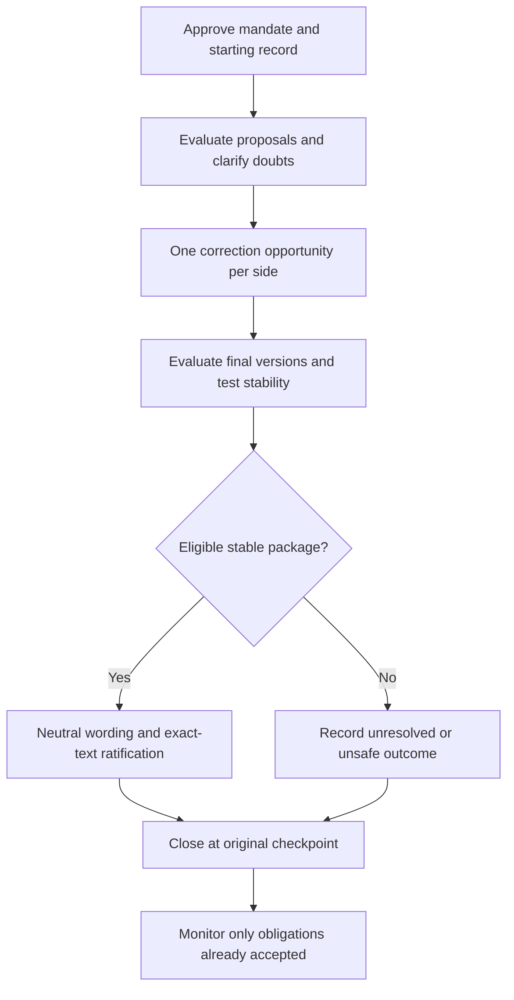

# Universal Negotiation Protocol

**UNP v0.1.0 — research draft, 30 October 2026**

A bounded negotiation protocol for **persistent coexistence among actors who retain their own identities**. Completion means that every side has had one opportunity to correct its position, the outcome has been recorded in neutral terms, and the procedure has returned to its starting checkpoint. Complete cooperation or agreement on a worldview is not required.

Concept initiated by Nikita Beregovykh. This repository formalizes the accompanying circular negotiation model and the subsequent discussion. It is a proposed framework, not an adopted international standard or a professionally certified peace process.

## Core rules

1. Exactly one authorized representative per recognized side. Advisors, experts, interpreters, and affected communities have defined channels without multiplying that side's decision seats.
2. One complete correction round per negotiation. Each side receives one equal revision opportunity against the same starting record. Retaining a position is a valid response.
3. A measurable logic-time stability test and a hard deadline. Expiration produces an explicit unresolved outcome when stability has not been demonstrated.
4. Neutral terms act as a common peacemaking operator for every actor: preserve intended meaning, expose obligations and uncertainty, and remove avoidable ambiguity without imposing cultural uniformity.
5. Acknowledged reasoning mistakes are recorded, corrected, and accompanied where appropriate by a culturally acceptable request for forgiveness. Forgiveness is voluntary; the record and responsibility remain.
6. Every proposal and material revision requires an expert evaluation tied to its exact version, relevant current data, and conflict-specific guidelines.
7. An independent agency prepares those guidelines under a mandate approved by every side before the cycle begins. SI/AI can assist; accountable qualified professionals sign the assessment.
8. No discretionary procedural veto after entry. No actor or agency may suppress a valid submission, erase a dissent, halt the agreed clock, or extend the round alone. Each actor retains consent over its own new obligations.

**Interpretation of “no veto”:** unanimous agency authorization is an entry condition. It necessarily allows a side to withhold that authorization. Once the mandate is accepted, nobody has a special veto over the procedure or evidence. Refusal to undertake one's own new obligation remains possible. See [Governance](docs/GOVERNANCE.md).

## Read the protocol

| File | Purpose |
|---|---|
| [PROTOCOL.md](PROTOCOL.md) | Normative roles, cycle, gates, and outcomes |
| [Mathematical model](docs/MATHEMATICAL-MODEL.md) | Geometry, one orbit, stability, neutral operator |
| [Governance](docs/GOVERNANCE.md) | Agency independence, representation, consent, no veto |
| [Expert evaluation](docs/EXPERT-EVALUATION.md) | SI/AI role, professional review, current evidence |
| [Mistake and repair](docs/MISTAKE-AND-REPAIR.md) | Logical errors, acknowledgement, forgiveness, remedy |
| [Conflict guidelines template](templates/CONFLICT-GUIDELINES.md) | Mandate agreed before a negotiation |
| [Proposal evaluation template](templates/PROPOSAL-EVALUATION.md) | Evaluation attached to a precise proposal |
| [Neutral closure template](templates/NEUTRAL-CLOSURE.md) | Agreed terms and preserved disagreement |
| [Worked example](examples/WORKED-EXAMPLE.md) | Fictional two-party coexistence case |
| [Sources and limits](docs/SOURCES-AND-LIMITS.md) | Provenance, source scope, unresolved research |
| [Validation record](docs/VALIDATION.md) | Completed checks and explicit validation limits |

## Procedure



The diagram's path contains no automatic return to corrections. Monitoring may trigger an incident record or a newly consented negotiation; it does not silently reopen the closed one.

## Machine-readable example

[session.json](examples/session.json) is a **synthetic closed-session record**. Its actors, agency, reviews, sources, and signatures are demonstrations only. They are not professional approvals. The compact [schema](schemas/session.schema.json) and [validator](scripts/validate.py) check selected structural invariants; they cannot verify truth, independence, professional credentials, authentic signatures, coercion, or real-world stability.

With Python 3.10 or later, no third-party packages are required:

```sh
python3 scripts/validate.py examples/session.json
python3 -m unittest discover -s tests -v
```

The hand-written validator implements the named conformance checks in its source; it is not a general JSON Schema interpreter. The schema supplies an additional structure contract for compatible external validators.

## Status and use

This version contains no real conflict assessment, current global data feed, certified SI system, or appointed independent agency. A real deployment must complete its context-specific mandate and professional reviews. “Universal” describes a reusable procedure; applicability to a particular conflict remains to be established.

No software or content license is granted in this version. Repository visibility alone is not a license. Licensing and institutional adoption remain decisions for the owner.
